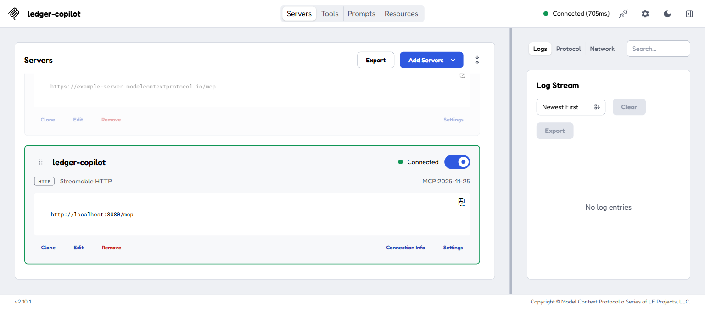
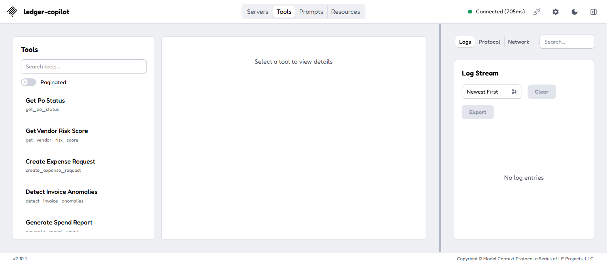
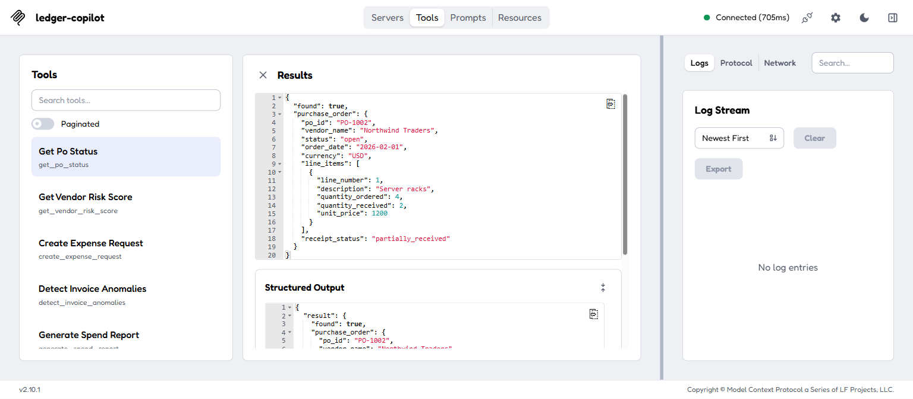
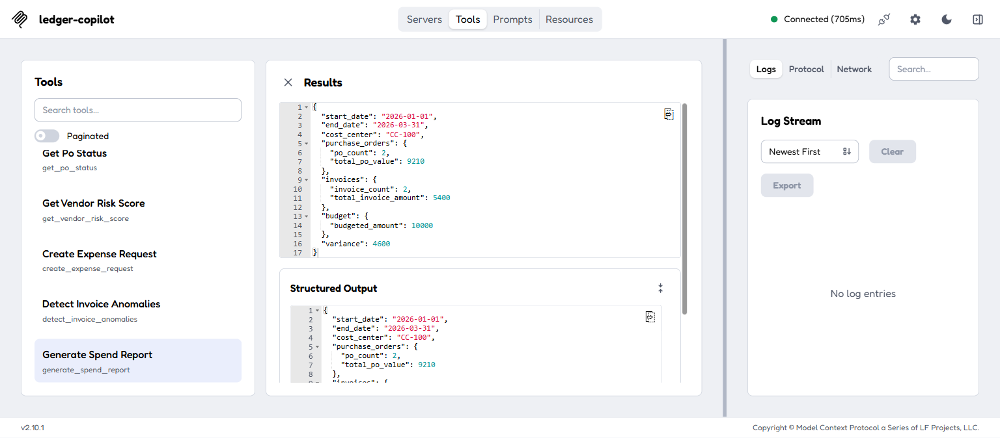

# Ledger Copilot MCP

A production-shaped [Model Context Protocol](https://modelcontextprotocol.io)
server that gives an enterprise chatbot governed access to procurement and
finance data: purchase orders, invoices, vendor risk, expenses, and spend
reporting.

Portfolio project demonstrating enterprise MCP engineering — tool calling
treated as a governed API surface (auth, audit, rate limiting, threat
modeling), not a toy integration.

## Demo

Running via Docker Compose, inspected with the official
[MCP Inspector](https://github.com/modelcontextprotocol/inspector).

| | |
|---|---|
|  |  |
|  |  |

## Tools

Five tools, each demonstrating a different production concern rather than
five variations on the same CRUD pattern:

| Tool | Scope | Tier | What it showcases |
|---|---|---|---|
| `get_po_status` | `procurement:po:read` | read | A real SQL lookup (SQLite) with computed state (receipt status derived from line items, not stored) |
| `get_vendor_risk_score` | `procurement:vendor:read` | read (external) | Calling a genuine external API (OpenSanctions) safely — timeout, exponential-backoff retry, circuit breaker |
| `create_expense_request` | `finance:expense:write` | write | Safe writes: idempotency-key dedup, scoped per verified actor so one caller can't read back another's cached result |
| `detect_invoice_anomalies` | `procurement:invoice:read` | read (scoring) | Pure, framework-free scoring logic (population z-score) that's unit-testable in isolation from MCP |
| `generate_spend_report` | `finance:report:read` | read (long-running) | Streaming MCP progress notifications while aggregating multiple data sources |

Plus 1 resource (`procurement://policies/{doc_id}`) and 1 prompt
(`/quarterly-review`).

## Architecture

```
auth → rate_limit → tracing → audit(pre) → [tool handler] → audit(post) → error_handling
```

Every tool call passes through this chain before/after the handler runs —
none of it lives inside the tools themselves:

- **auth** — rejects first, before anything else runs (see below)
- **rate_limit** — token bucket per authenticated `client_id`
- **tracing** — opens one OpenTelemetry span per call, parented to the
  incoming `traceparent` header if present
- **audit** — wraps the handler on both sides so it records the outcome
  even when the call fails
- **error_handling** — outermost, so nothing throws unhandled into the
  transport layer

```
src/ledger_copilot/
├── tools/         # thin MCP adapters — no business logic
├── domain/        # business logic, framework-agnostic
├── integrations/  # ERP fixture client, vendor-risk API client
├── middleware/     # auth, rate_limit, tracing, audit, error_handling
└── audit/         # append-only SQLite store
```

`domain/` never imports FastMCP, so business logic is testable in isolation
and honest about not depending on the transport layer.

## Security

- **Auth** — OAuth 2.1 resource server (RFC 9728 discovery, JWT/JWKS
  verification, audience-bound). Authentication (who you are) happens once,
  transport-level, via a verified bearer token. Authorization (what you can
  call) is then per-tool: each tool is registered with a required scope
  (e.g. `finance:expense:write`), and the `auth` middleware compares that
  against the scopes in the caller's *verified token* — never anything the
  caller's request arguments claim — before the tool handler runs at all.
  Missing/expired/wrong-audience tokens get a 401; a valid token lacking
  the tool's scope gets a 403
- **Audit** — one append-only SQLite record per call (DB-level
  `UPDATE`/`DELETE` triggers reject tampering), sensitive fields hashed
- **Idempotency is actor-scoped** — a reused idempotency key from a
  different verified actor never returns someone else's cached result
- **Resilience** — the vendor-risk API call has a timeout, exponential
  backoff, and a circuit breaker
- **Threat-model tested** — `tests/integration/test_threat_model.py` has a
  concrete, passing test per threat: confused deputy, token passthrough,
  idempotency-key hijacking, tool poisoning, prompt injection, SSRF

No auth is required by default (`LEDGER_COPILOT_AUTH_JWKS_URI` unset) — it's
a local demo. Set that plus `AUTH_ISSUER`/`AUTH_AUDIENCE` to turn on real
JWT auth.

## Running it

```bash
docker compose up --build
curl http://localhost:8000/healthz
```

Or locally:

```bash
python -m venv .venv && source .venv/Scripts/activate
pip install -e ".[dev]"
python -m ledger_copilot.server
```

Config is env-driven (`LEDGER_COPILOT_*`, see `.env.example`) via
pydantic-settings — same variable names locally and in production (Key
Vault / `ExternalSecret`), no code path changes.

## Testing

```bash
pytest && ruff check . && mypy src
```

85 tests split by layer: `tests/unit/` (domain/integrations in isolation),
`tests/integration/` (full app, including auth/audit/threat-model),
`tests/contract/` (tool JSON-Schema conformance).

## Deployment

`Dockerfile` is a two-stage, non-root build. `deploy/k8s/` has
configmap/secret/pvc/deployment/service/hpa manifests — deliberately pinned
to 1 replica since the audit store is SQLite on a single RWO volume (see
`audit/store.py` for the documented Postgres swap-in for multi-replica).

## Non-goals

No UI, no real ERP integration (fixture-backed; OpenSanctions is the one
genuinely external API), no custom LLM orchestrator, no full OPA
deployment.
