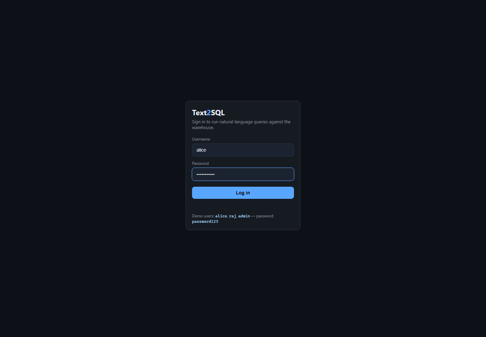
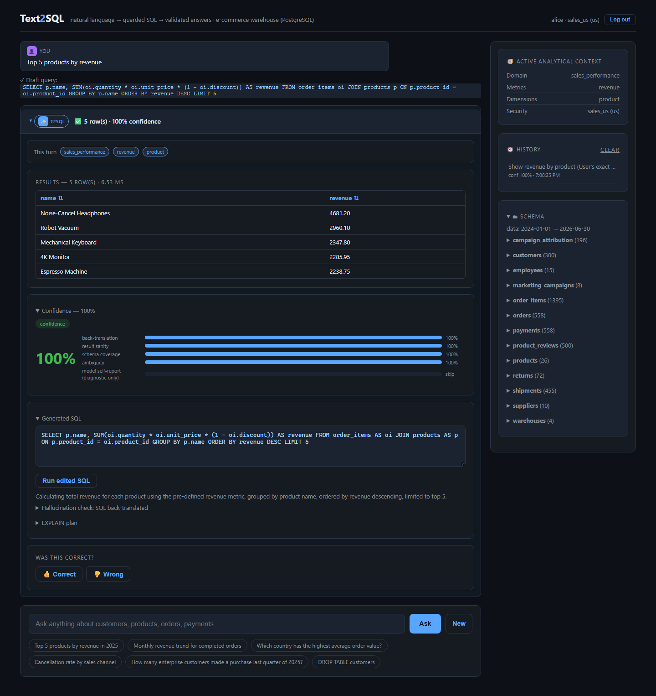
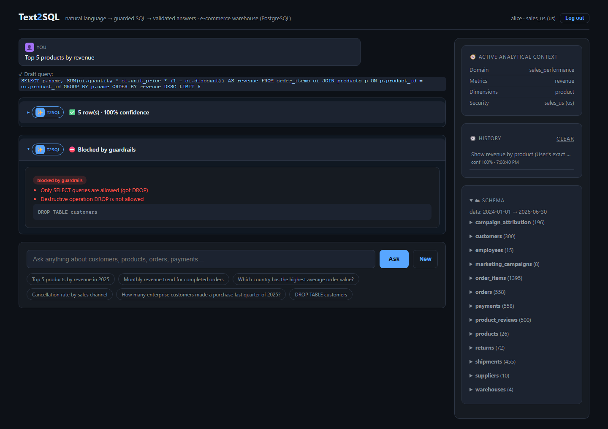
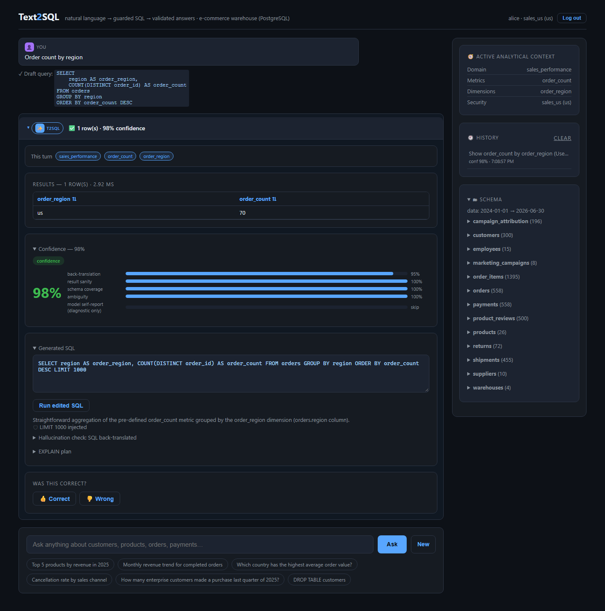
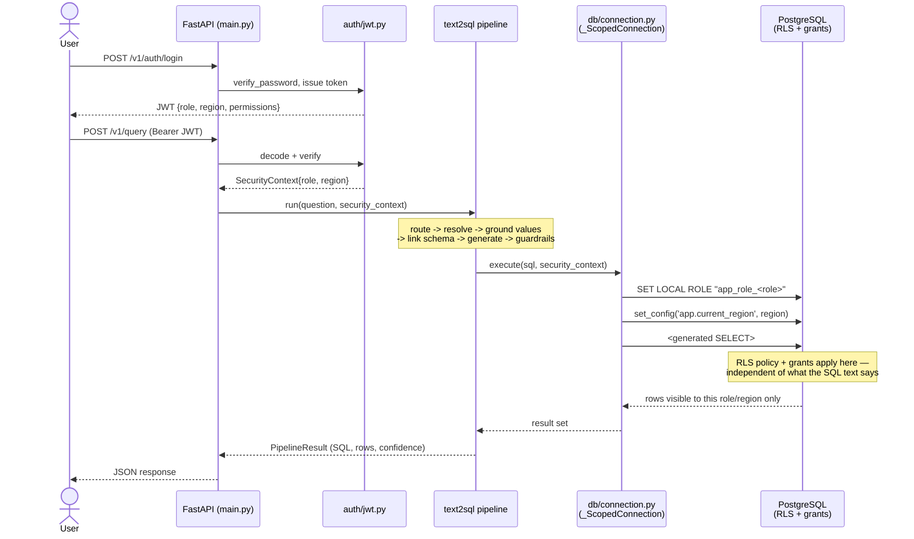

# Text2SQL

A natural-language-to-SQL platform that answers business questions against a
real PostgreSQL warehouse — not by handing a schema dump to an LLM, but
through a governed pipeline: a curated semantic layer constrains what can be
asked, deterministic resolution decides which tables that maps to, SQL-AST
guardrails and a cost guard sit between generation and execution, PostgreSQL
row-level security enforces per-tenant visibility independently of the SQL
text, and every step is scored, audited, and traced. A LangGraph-based
conversational layer sits on top, so follow-up questions, clarifications,
and multi-turn context work the way a human analyst would expect.

**Capabilities:** natural-language → SQL generation · curated semantic layer
(metrics/dimensions/joins) · structured LLM routing with a deterministic
resolution backstop · filter-value grounding · SQL AST guardrails
(`sqlglot`) · query-cost guard + statement timeout · self-repair on
execution error · multi-turn conversational agent (LangGraph) with
clarification handling and durable session memory · versioned prompt
registry · PostgreSQL row-level security + role-aware column masking · JWT
auth/RBAC · audit trail + human-reviewed feedback promotion · OpenTelemetry
tracing · offline-reproducible evaluation harness with confidence intervals.

**Stack:** Python, FastAPI, asyncpg, PostgreSQL 16 (native RLS) ·
LangGraph · Groq / Anthropic / AWS Bedrock (structured outputs) · sqlglot ·
OpenTelemetry + Jaeger · pytest · Docker Compose · GitHub Actions CI.

## In action

| | |
|---|---|
|  Role-based login — three demo accounts, each mapped to a different Postgres role and region. |  A question resolved end-to-end: generated SQL, per-signal confidence breakdown, and results. |
|  `DROP TABLE customers` rejected before it reaches Postgres, with the guardrail explaining why. |  Same question, different user — `alice` (`sales_us`) only ever sees `region = 'us'` rows, enforced by Postgres itself. |

## Pipeline architecture

A question moves through a fixed sequence of stages, each independently
testable with injectable LLM/DB calls (`app/text2sql/pipeline.py`):

```
question
  │
  ▼
1. Semantic routing (router.py)        LLM, structured output — classifies
  │  needs clarification? ──yes──▶ stop   against the curated domain/metric/
  ▼  ok                                   dimension catalog
2. Deterministic resolution             canonical-id lookup, synonym fallback
  │  (SchemaResolver)                    → physical tables; zero or multiple
  │  ambiguous? ──yes──▶ stop             matches → clarify, never guess
  ▼  ok
3. Value grounding (ValueResolver)      filter values → curated alias or
  │  unresolved? ──yes──▶ stop            bounded, RLS-scoped DB lookup
  ▼  ok
4. Schema linking (LinkedSchema)        explicit join path + resolved
  │                                      metrics/filters
  ▼
5. Generation (Groq / Claude / Bedrock) structured output, seed + verified-
  │                                      query few-shots
  ▼
6. Guardrails (sql_validator.py)        sqlglot AST: SELECT-only, single
  │                                      statement, depth limit, LIMIT inject
  ▼
7. Cost guard (cost_guard.py)           join-count/depth heuristic + EXPLAIN
  │                                      cost ceiling
  ▼
8. Execution (RLS + column masking)     SET LOCAL ROLE + region GUC — RLS
  │  error? ──yes──▶ 9. Repair-on-error  policies/grants apply regardless of
  │                     (re-guardrailed, re-enters 8)   the SQL text
  ▼  ok
10. Validation (validation.py)          back-translation · result sanity ·
  │                                      schema coverage
  ▼
11. Confidence score                    weighted blend; model self-report
  │                                      shown but never weighted
  ▼
audit log entry + OpenTelemetry trace span (every stage above is its own
span, correlation-id-linked to the audit row)
```

Module boundaries behind each stage: `app/semantic/router.py`,
`app/semantic/resolver.py` (`SchemaResolver`),
`app/semantic/value_resolver.py`, `app/text2sql/schema_linker.py`,
`generator.py`, `verified_queries.py`, `app/guardrails/sql_validator.py`,
`app/guardrails/cost_guard.py`, `app/db/executor.py` + `connection.py`,
`app/text2sql/sql_repair.py`, `app/validation/validation.py`,
`app/audit/audit_log.py`, `app/observability/tracing.py`.

## Semantic layer and deterministic resolution

Table and column selection is driven by a curated semantic layer
(`app/semantic/layer.yaml`) — metrics, dimensions, joins, and synonyms
declared once — not a bare keyword match against the schema, so "spend"
resolves to the metric actually meant instead of whichever column shares the
word.

An LLM router classifies the question against that catalog, but nothing
downstream trusts it blindly: a deterministic resolver maps each result to
exactly one canonical concept, and anything unresolved or ambiguous triggers
clarification rather than a guess. Filter *values* go through the same
grounding — a curated alias map or a bounded, RLS-scoped lookup — so an
unmatched value never silently becomes literal filter text. Approved past
Q→SQL pairs are also scored and reused as few-shot examples for generation.

No LLM key configured falls back to keyword retrieval, so the full test
suite and `eval/run_eval.py --offline` run without one.

## Conversational agent layer

A LangGraph state machine sits in front of the pipeline for multi-turn
interaction: it classifies a fresh message as a new question or a follow-up,
merges follow-ups against the session's existing state instead of re-running
blind, and pauses for clarification on real ambiguity — resuming against the
reply, not the original message.

The full conversation is always persisted to PostgreSQL unmodified; once it
would exceed a configurable token budget, older turns are folded into a
running summary rather than truncated, so a reloaded page can always
rehydrate the chat panel. Every LLM-facing prompt is also versioned
(`app/prompts/<name>/v1.py`, `v2.py`, …) with an env-var override to pin or
roll back a specific one without a redeploy — old versions are never
overwritten.

## Security and platform engineering

Every request authenticates via JWT into a `SecurityContext` (role, region,
permissions) that's threaded straight to the database connection: before any
generated SQL runs, it issues `SET LOCAL ROLE` and sets a region session
variable. From there, **Postgres's own grants and row-level-security
policies apply regardless of what SQL text was generated** — guardrails, a
role with no write privilege, and RLS are three independent layers, not one
mechanism relied on three times.



Demo users (password `password123` for all three):

| User | Role | Region | Sees |
|---|---|---|---|
| `alice` | `sales_us` | `us` | order-derived tables scoped to `region = 'us'`; masked customer email |
| `raj` | `sales_india` | `india` | same, scoped to `india` |
| `admin` | `admin` | `*` | every region, unmasked |

A few other platform pieces, each independent and each kept simple on
purpose:

- **Audit trail** — every query (question, SQL, outcome, confidence) is
  written to an append-only log; 👍/👎 feedback only promotes into the
  few-shot prompt path after explicit human approval, never automatically.
- **Cost governance** — a static complexity check before execution, an
  `EXPLAIN`-based check after, and a hard statement timeout as the backstop.
- **Observability** — every pipeline stage is its own OpenTelemetry span,
  correlation-id-linked to its audit row, exported to Jaeger.

## Evaluation

`eval/golden.json` holds 44 guardrail/adversarial cases and 67 text2sql
execution-accuracy cases. Accuracy is scored by running the generated and
reference SQL against the same database and comparing **result sets**, never
SQL text — with a 95% confidence interval per category, since these are real
numbers from a non-deterministic LLM, not a curated benchmark.

Measured against a live Groq/Anthropic key and Postgres instance:

```
Execution accuracy by category (vs golden reference SQL):
  simple                9/12  (75%) — 95% CI [43%, 95%]
  aggregation           10/13 (77%) — 95% CI [46%, 95%]
  join                  8/13  (62%) — 95% CI [32%, 86%]
  temporal              9/12  (75%) — 95% CI [43%, 95%]
  ambiguous             5/11  (45%) — 95% CI [17%, 77%]
  paraphrase_robustness 2/5   (40%) — 95% CI [5%,  85%]
  value_grounding       0/1   (0%)  — 95% CI [0%,  98%]
  overall               43/67 (64%) — 95% CI [52%, 76%]

  semantic router accuracy      : 5/6 (83%) — 95% CI [36%, 100%]
  clarification handling        : 6/6 (100%) — 95% CI [54%, 100%]
  NL prompt-injection defended  : 5/5 (100%) — 95% CI [48%, 100%]
```

What runs for real, offline, with no API key and no live database — the
deterministic guardrail/adversarial battery:

```
GUARDRAIL / ADVERSARIAL EVAL (offline) — 44 total cases
  dangerous + adversarial blocked : 27/27 (100%) — 95% CI [87%, 100%]
  limit transforms applied        : 3/3
```

Reproduce: `python eval/run_eval.py --offline` (no key, no DB) ·
`python eval/run_eval.py` (full suite, needs a live Postgres + LLM key) ·
`python -m pytest tests/ -q` (297 passed — the live-Postgres integration
tests in `tests/test_db/` and `tests/test_security/` self-skip without a
reachable database locally, and run for real in CI).

## Quickstart

```bash
docker compose up -d              # PostgreSQL 16 + Jaeger, no local install needed

python -m venv .venv
.venv\Scripts\activate            # Windows   (source .venv/bin/activate on mac/linux)
pip install .                     # or: pip install ".[dev]" to also run the test suite

python data/seed.py                                  # 13-table sample warehouse (seed=42)
                                                       # run this FIRST — it recreates the
                                                       # public schema from scratch
psql "$DATABASE_ADMIN_URL" -f app/auth/schema.sql     # identity/RBAC tables + demo users
psql "$DATABASE_ADMIN_URL" -f app/db/policies.sql     # per-role Postgres roles + RLS + masking
# grant the app's connecting DB user permission to switch into each role, e.g.:
#   GRANT app_role_sales_us, app_role_sales_india, app_role_admin TO text2sql;
psql "$DATABASE_ADMIN_URL" -f app/db/agent_schema.sql  # session storage for the agent layer

copy .env.example .env            # then add a key: GROQ_API_KEY (free, console.groq.com)
                                   # or ANTHROPIC_API_KEY — provider is auto-detected

uvicorn app.main:app --port 8000
# open http://localhost:8000, log in as alice / raj / admin (password: password123)
```

Continuous integration (`.github/workflows/ci.yml`) runs this same sequence
against a Postgres 16 service container on every push/PR to `main`, so the
live-Postgres tests actually execute in CI, followed by the offline
guardrail eval.

The app itself can also run as the container built from the repo's own
`Dockerfile` instead of the local `uvicorn` command above (non-root,
multi-stage, same `EXPOSE 8000`) — `docker build -t text2sql-app .`, then
`docker run --env-file .env -e DATABASE_URL=... -p 8000:8000 text2sql-app`.
The seed/schema steps above still need to be applied against the same
Postgres first, from the host or via `docker exec <container> python
data/seed.py` for the seed step specifically.

### Configuration

All settings are environment-driven (`app/config.py`, loaded via `.env`).
The ones most worth knowing about beyond `DATABASE_URL` and a provider API
key:

| Variable | Default | Purpose |
|---|---|---|
| `TEXT2SQL_ROW_LIMIT` | `1000` | Row cap injected into generated queries |
| `TEXT2SQL_MAX_JOIN_COUNT` | `4` | Cost-guard join-count ceiling |
| `TEXT2SQL_MAX_QUERY_COST` | `100000` | Cost-guard `EXPLAIN`-cost ceiling |
| `TEXT2SQL_QUERY_TIMEOUT_S` | `10` | Hard statement timeout |
| `TEXT2SQL_MAX_AGENT_STEPS` | `6` | Per-turn cap on agent tool/loop steps |
| `TEXT2SQL_HISTORY_TOKEN_BUDGET` | `3000` | Transcript budget before summarization kicks in |
| `TEXT2SQL_PROMPT_VERSION_OVERRIDES` | `{}` | Per-family prompt version pin, e.g. `{"merge":"v1"}` |
| `TEXT2SQL_JWT_SECRET` | dev fallback | **Must** be set outside local dev |
| `TEXT2SQL_LOGIN_RATE_LIMIT` | `5` | Login attempts per window before `429` |
| `TEXT2SQL_OTLP_ENDPOINT` | `localhost:4318` | Jaeger/OTLP collector endpoint |

## Project layout

```
app/
  main.py                 FastAPI app + router wiring + startup lifespan
  config.py                env-driven settings
  routes/                  auth, query, sessions, history, feedback, admin endpoints
  agent/                   LangGraph conversational layer: graph wiring, nodes/,
                           session memory + summarization, session_store.py
  prompts/                 versioned prompt registry, one package per prompt family
  text2sql/                pipeline orchestration, schema linking, generation,
                           verified-query retrieval, repair-on-error
  semantic/                layer.yaml, SemanticLayer + SchemaResolver, router,
                           value_resolver.py
  guardrails/              SQL-AST safety (sql_validator.py) + cost_guard.py
  db/                      connection pooling + SecurityContext scoping, executor,
                           policies.sql
  auth/                    JWT issuing/verification, RBAC model, schema.sql
  validation/              hallucination detection: back-translation, sanity, confidence blend
  evaluation/              execution-accuracy scoring + Clopper-Pearson rollup
  audit/                   audit log + feedback store
  observability/           OpenTelemetry tracer setup + span helpers
  middleware/               correlation-id + structured request logging
  static/index.html         dashboard
data/seed.py                deterministic 13-table sample warehouse
eval/                       golden.json (111 cases) + run_eval.py
tests/                      unit + live-Postgres integration tests, mirroring app/
scripts/promote_feedback.py offline/CLI feedback-promotion counterpart
docker-compose.yml           PostgreSQL 16 + Jaeger
render.yaml                  Render.com deploy config
.github/workflows/ci.yml     Postgres service container + pytest + offline eval
```

## Explicitly out of scope

- **No distributed rate limiting.** Login throttling
  (`app/auth/rate_limiter.py`) is a process-local, in-memory sliding window —
  sufficient for a single instance; a multi-replica deployment would move
  this to a shared store without changing anything else.
- **No external identity provider.** Auth is a self-contained JWT +
  Postgres `users` table, not OAuth/OIDC. The RBAC/RLS mechanism this
  project demonstrates — a `SecurityContext` resolved from a JWT determining
  what Postgres itself lets a query see — works identically regardless of
  where the JWT's claims originate.
- **No embedding-based schema retrieval or multi-agent schema discovery.**
  The current schema is small enough for a curated semantic layer plus a
  classifier to outperform retrieval infrastructure. Semantic routing and
  physical-schema resolution sit behind stable interfaces specifically so
  retrieval could be added later without touching generation, guardrails, or
  anything downstream, if schema scale ever justified it.
